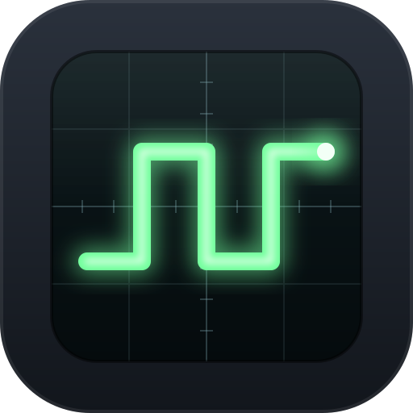
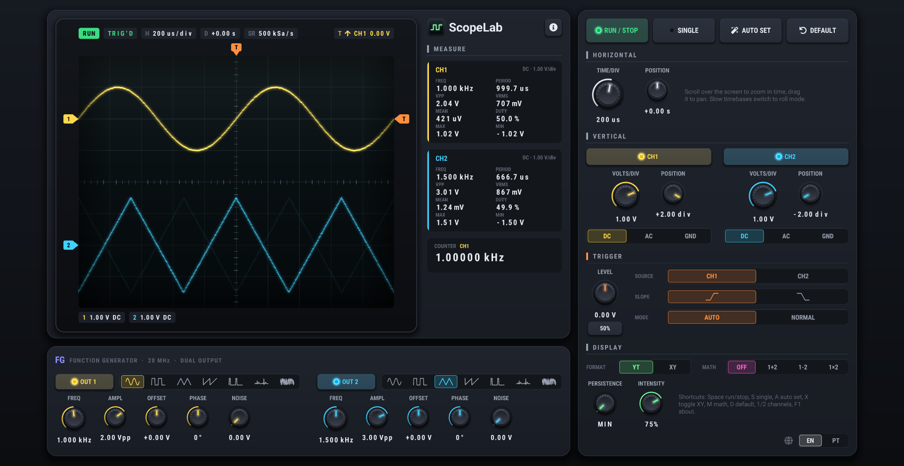

**EN** | [PT-BR](README.pt-BR.md)

# ScopeLab

A bench oscilloscope simulator. I created it for electronics classes, but feel free to use it for other purposes. This project is licensed under the MIT License.

## Features

- Dual-channel oscilloscope with edge trigger (Auto, Normal and Single)
- Two-output function generator: sine, square, triangle, ramp, pulse, ECG and noise
- Phosphor display with adjustable persistence
- XY mode (Lissajous figures) and math traces
- Automatic measurements and frequency counter
- Auto Set, plus an English and Portuguese interface

