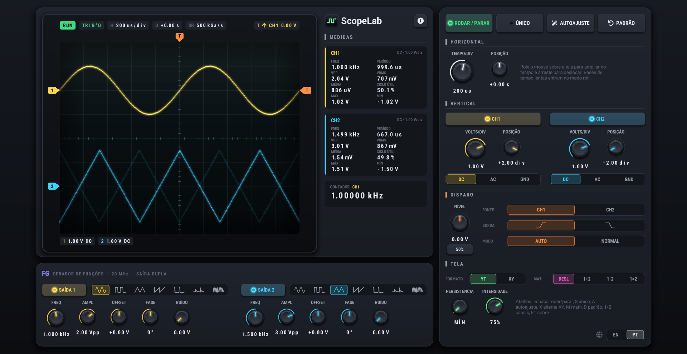

[EN](README.md) | **PT-BR**

# ScopeLab

Um simulador de osciloscópio de bancada. Criado por mim para aulas de eletrônica, mas sinta-se à vontade para usar para outras finalidades. Projeto sob a licença MIT.

## Funções

- Osciloscópio de dois canais com disparo por borda (Auto, Normal e Único)
- Gerador de funções com duas saídas: senoidal, quadrada, triangular, rampa, pulso, ECG e ruído
- Tela de fósforo com persistência ajustável
- Modo XY (figuras de Lissajous) e traços matemáticos
- Medições automáticas e contador de frequência
- Autoajuste e interface em inglês e português

